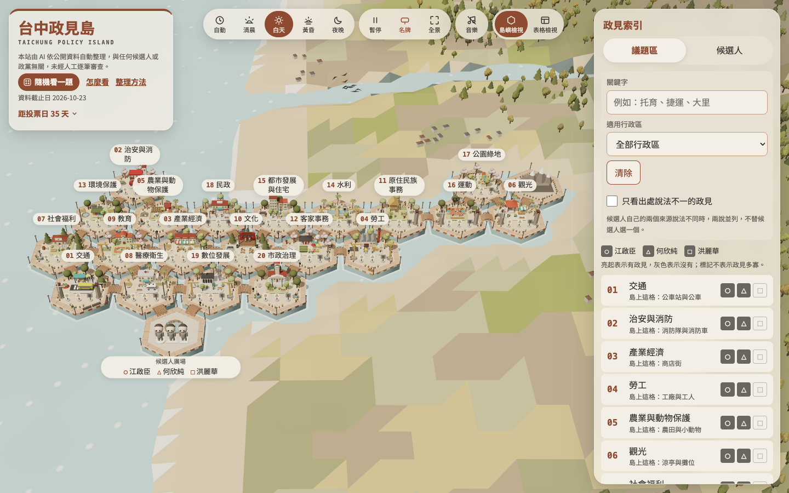
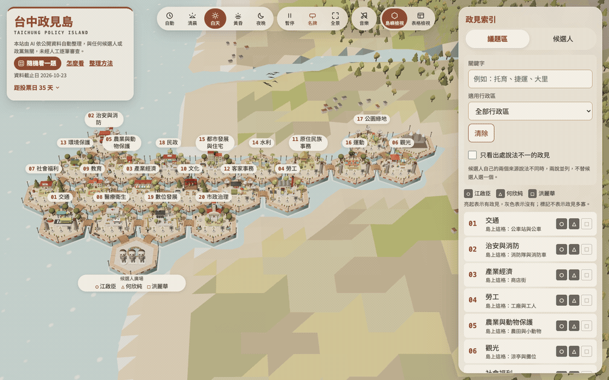
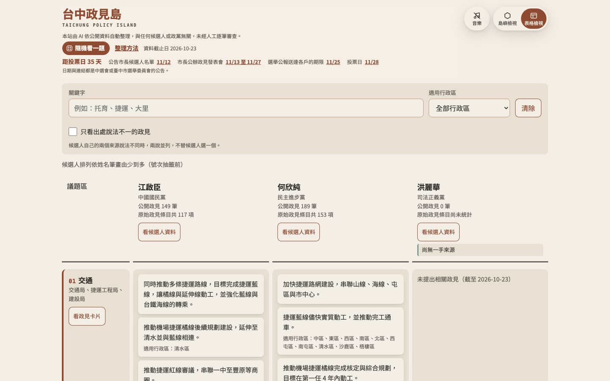

<div align="center">

# 台中政見島

**Taichung Policy Island**

### 從你在意的議題出發，看看每位候選人說了什麼。

一個把 2026 台中市長候選人政見放在同一座島上、並排對照的個人 side project。

[開啟網站](https://tc-policy-island.pages.dev) · [表格檢視](https://tc-policy-island.pages.dev/?view=table) · [整理方法](https://tc-policy-island.pages.dev/method.html) · [回報更正](https://github.com/kcchien/tc-policy-island/issues)

原生 ES 模組 · three.js · Node 24 · Cloudflare Pages

</div>

[](https://tc-policy-island.pages.dev)

> **揭露聲明**：本站由 AI 依公開資料自動整理，與任何候選人或政黨無關，未經人工逐筆審查。不評分、不排名、不推薦候選人；每條公開政見都附原文引述與一手來源，供讀者自行查證。

## 這座島在做什麼？

把散在候選人官網、官方臉書、政見發表會與選舉公報的政見，依公共議題整理到同一處。選一個議題區，就能並排閱讀每位候選人的政見，再循著原文引述回到出處。

島嶼檢視讓議題變成可以走近的小型場景；表格檢視方便逐項對照。兩種檢視使用同一份資料，也共用政見卡片。

## 看看怎麼用

### 選一個議題，三人走到同一格

點開議題區時，三位候選人人物同時出發、同時抵達，再展開並排的政見卡片。尚無政見的人也照樣到場，保留完整的對照位置。



### 想逐項閱讀，也可以直接看表格

議題區與候選人交叉排列，可搜尋關鍵字、篩選適用行政區，再開啟政見卡片查看原文與出處。

[](https://tc-policy-island.pages.dev/?view=table)

*截圖與動畫取自本機正式資料建置；畫面中的資料截止日與選舉時程為拍攝當時狀態，最新內容請以網站為準。*

## 可以做的事

| 想做什麼 | 網站怎麼幫忙 |
| --- | --- |
| 從關心的事情開始 | 依議題區、關鍵字或適用行政區找到政見，也可以隨機看一題。 |
| 比較同一個議題 | 三位候選人並排，尚無資料的欄位照常顯示；標記只表示有無政見。 |
| 回到原文查證 | 每條政見附摘要、原文引述、一手來源與核對紀錄；出處說法不一時兩說並列。 |
| 把對照帶走 | 「我的對照單」可勾選政見、列印或用網址分享；也可複製單條政見與出處。 |
| 接著讀，或用聽的 | 「下一題」接續閱讀，閱讀進度留在自己的瀏覽器；朗讀使用三人相同的聲音設定。 |
| 補上缺漏 | 空欄位提供一手來源回報入口，修正與補件過程公開在 GitHub Issues。 |

## 中立原則如何落實？

中立規則同時約束資料、畫面與互動：

- **相同的呈現待遇**：候選人依號次排序，抽籤前依姓名筆畫排序；篇幅、字級、人物造型與動作規則一致。
- **場景不替政見加分**：島上標記不表示政見數量；裝飾與動態依議題區配置，不依哪位候選人有政見決定。
- **每條政見先核對再公開**：原文引述先做逐字比對，再由未參與抽取的 AI 依公開檢核表檢查摘要。
- **整理過程可檢視**：分類規則、檢核表、提示詞與核對報告全文公開。AI 核對不代表內容絕無錯誤，仍保留原文與更正管道。

完整規則見 [中立規則](docs/adr/0001-neutrality-rules.md)；採用 AI 核對的理由與限制見 [核對方式的決策紀錄](docs/adr/0002-ai-verification-instead-of-human-review.md)。

## 技術與設計選擇

網站以靜態檔案為主，前端不用框架、不打包。three.js 隨專案保存，以 importmap 載入；工具與測試只用 Node 24 內建模組，不需要安裝 npm 套件。

| 部分 | 做法 |
| --- | --- |
| 網頁與介面 | HTML、原生 ES 模組、手寫 CSS 變數。 |
| 島嶼場景 | three.js；不支援 WebGL 時改用表格檢視。 |
| 資料流程 | 一手來源 → 抽取與兩層核對 → 建置公開資料集 → 兩種檢視。 |
| 品質檢查 | `node:test` 與上線關卡，檢查資料、品牌用語、禁用色與呈現一致性等規則。 |
| 部署 | Cloudflare Pages；唯一的 Pages Function 是不讀取或記錄可識別讀者資料的統計端點。 |

進一步閱讀：[專案架構](docs/architecture.md) · [詞彙表](GLOSSARY.md) · [統計端點的決策紀錄](docs/adr/0003-hit-counter-on-pages-function.md)

## 本機執行

需要 **Node 24 以上**。下載專案後即可執行，不需要 `npm install`。

```sh
git clone https://github.com/kcchien/tc-policy-island.git
cd tc-policy-island
npm run preview
```

開啟 <http://localhost:8000/>。預覽指令會先將 `data/raw/` 建置成公開資料集。

```sh
npm run check              # 測試 → 建置 → 上線關卡
node --test                # 只跑測試
node scripts/build.js      # 建置公開資料集
node scripts/gates.js      # 檢查建置後的網站
```

### 專案導覽

```text
site/                 網站頁面、樣式與 ES 模組
  vendor/three/       隨專案保存的 three.js
  data/               建置後的公開資料，不進版控
data/
  raw/                從一手來源抽取的真實資料
  snapshots/          核對用的原文存檔
  extraction/         抽取指示與紀錄
  verification/       檢核表、提示詞與核對報告
scripts/              建置、核對、上線關卡與維護工具
test/                 測試與虛構候選人的夾具資料
docs/                 架構、公開規則與決策紀錄
```

### 維護工具

<details>
<summary>截圖與版面量測</summary>


`scripts/shoot.js` 用本機的 Chrome（無頭模式，透過 Chrome DevTools Protocol）截圖，不需要安裝套件。沒給 `--url` 時會自己開本機預覽，所以先跑一次建置。

```sh
node scripts/shoot.js --out shots/desktop.png                                  # 桌面 1440x900、白天
node scripts/shoot.js --device phone --time night --out shots/phone-night.png  # 手機 390x844（三倍像素、觸控）
node scripts/shoot.js --device laptop --area transportation --out shots/area.png
node scripts/shoot.js --device phone --click '#tool-index' --out shots/index.png
node scripts/shoot.js measure --device phone --strict                          # 名牌重疊與水平捲動，有問題時結束碼 1
```

預設行為：

- 裝置寬度用模擬設定，不靠視窗大小（無頭 Chrome 的視窗有最小寬度，390px 會被撐寬）。
- 預設減少動態：鏡頭與時段直接到位、動畫停在固定畫格，同樣的參數截出同樣的畫面。`--motion full` 時每一步之後會等鏡頭飛行與時段補間跑完。
- 預設白天，不依執行當下的時間；`--time auto` 才依台灣時間。
- 等頁面就緒（資料載入、島嶼場景建好）後再多等幾個畫格；WebGL 退回軟體繪圖時會提示，等待以畫格計，不會截到還沒畫好的畫面。

找不到 Chrome 時用 `--chrome` 或環境變數 `CHROME_PATH` 指定執行檔。

</details>

<details>
<summary>補送網頁備份</summary>


`scripts/fetch-source.js` 送 Wayback Machine 存檔失敗時，會依 60、120、240、480 秒退避重試；同一台機器上同時只有一個存檔流程，兩次送出至少隔 20 秒。重試後仍沒有存檔網址的出處，之後用下面的指令補送：

```sh
node scripts/fetch-source.js --retry-archive                    # 全部候選人
node scripts/fetch-source.js --retry-archive --candidate <id>   # 只補一位
```

</details>

<details>
<summary>部署到 Cloudflare Pages（維護者）</summary>


由維護者在本機執行，CI 只做檢查、不部署。本專案不裝 npm 套件，wrangler 要另外全域安裝（`npm install -g wrangler`），並先以 `wrangler login` 登入 Cloudflare。

```sh
npm run deploy               # 測試 → 建置 → 上線關卡 → 部署到 Cloudflare Pages 專案 tc-policy-island 的正式環境（main）
npm run deploy -- --dry-run  # 跑完全部檢查，只列出建立專案與部署的 wrangler 指令、不執行
```

任一步失敗就以結束碼 1 退出，不部署。Cloudflare Pages 專案不存在時會先建立。

</details>

## 回報更正與參與

發現錯誤，請到 [GitHub Issues](https://github.com/kcchien/tc-policy-island/issues) 附上政見卡片上的政見連結、你認為有誤的地方，以及可供核對的一手來源。修正後的政見仍須重新通過兩層核對才會公開。

若要修改程式碼或整理資料，請先閱讀 [專案慣例](AGENTS.md)、[詞彙表](GLOSSARY.md) 與 [中立規則](docs/adr/0001-neutrality-rules.md)，送出變更前執行 `npm run check`。示範與測試資料請使用虛構候選人，放在 `test/fixtures/`。

## 授權

整理內容（摘要、議題區、分類與資料結構）採 [CC BY 4.0](https://creativecommons.org/licenses/by/4.0/)，引用時請註明「台中政見島」並附本站網址。程式碼採 MIT（見 [LICENSE](LICENSE)）。原文引述與出處快照的著作權屬於各候選人，本站以引用方式呈現，供查證與比較。完整說明見[整理方法頁](https://tc-policy-island.pages.dev/method.html#license)。
